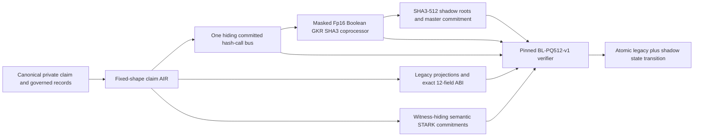

# Blind Ledger PQ-ZK claim-proof security architecture

Updated: 2026-08-05

Status: selected target architecture with a sealed nonactivating Gate 2E context, a validated exact
H5 K128/K512 p95/resource campaign, and a closed twelve-record H6 candidate-evidence manifest.
Production suite identity, the final independent audit, and approval for real PHI remain open.

Build boundary: the proof system, native hiding, strict-PQ suite, verifier, state, custody ports,
tests, and qualification evidence are internal engineering packages. Independent reviewers do not
select or implement them; the completed exact release later enters the single Security Audit Gate
defined by `docs/DEPLOYMENT_READY_BUILD_CONTRACT.md`.

This document is the canonical decision record for the claim proof's witness-hiding and
post-quantum security profile. The containing system is the direct atomic database architecture in
`docs/DATABASE_ZK_ARCHITECTURE.md`. No external roadmap item receives theorem, hiding, soundness,
or PQ credit before its exact implementation independently earns it.

## Compaction and handoff rule

After reading `AGENTS.md`, `docs/DATABASE_ZK_ARCHITECTURE.md`, and, in the full workspace, the
newest `STATE.md` section, every engineer or agent working on the claim proof, privacy boundary,
nullifier state, proof verifier, cryptographic commitments, or proving performance must read this
document and then
`docs/IMPLEMENTATION_ROADMAP.md`, `docs/BL_PQ512_THROUGHPUT_RECOVERY_PLAN.md`, and
`docs/BL_PQ512_HETEROGENEOUS_HASH_COPROCESSOR.md`.

The published source archive intentionally omits `STATE.md` and `WAVE2_HANDOFF_2026-07-26.md`.
When working from that archive, use the current architecture documents and
`RELEASE_FILE_MANIFEST.json` as the continuation record.

If working context is compacted or lost, re-read those files before continuing. Do not reconstruct
this decision from chat summaries.

For the later S07-S12 quantitative, encoding, lifecycle, and formal-statement work, also read
`docs/BL_PQ512_S07_S12_PREIMPLEMENTATION_FREEZE.md` and
`docs/bl_pq512_suite_candidate_v1.json`. Those artifacts deliberately leave the proof suite unset
and nonactivatable.

## Decision summary

We will preserve the external 12-field Privacy V2 application ABI: the same field count, order,
names, and `bytes32` types. We will not pretend that twelve Stark-field values are the complete
strict post-quantum security boundary.

The selected profile is `BL-PQ512-v1`:

1. A heterogeneous fixed-shape proof replaces the generic Cairo CPU and RISC-V paths: an
   application-specific M31 semantic AIR binds through one committed bus to an Fp16 Boolean GKR
   SHA3 coprocessor.
2. S-two/Circle-STARK remains the primary prover base only after a complete native witness-hiding
   layer is formally specified, implemented, and internally qualified; production activation also
   requires acceptance of the exact release by the final independent audit.
3. The existing 12 fields remain compatibility and application-state values.
4. An authenticated SHA3-512 proof sidecar and verifier-maintained SHA3-512 shadow state become the
   authoritative strict post-quantum binding layer.
5. The proof constrains one authoritative SHA3-512 structure over raw canonical claims, governed
   records, and ordered state operations; current one-felt ABI values are proved projections only.
6. Every real claim consumes an attempt nullifier regardless of approval or denial. Fixed padding
   slots consume cover nullifiers. Approval, denial, and padding use the same public shape.
7. The proof system's own commitments, transcript, soundness parameters, verifier identity, and
   persisted state authentication must meet the same selected quantum target.
8. The authoritative launch transcript is PQ-authenticated interactive public coin. Fiat--Shamir is
   disabled unless a future separately identified module passes its exact QROM reduction and gates.

RISC Zero remains a semantic and differential oracle. Its verified 12-field experiment remains
useful evidence, but the generic RISC-V proof path and its current security parameters are not the
selected production architecture. Plonky3's hiding FRI implementation is the independent
contingency prototype, not an audited shortcut.

## Current Phase 2 proof and resource boundary

Historical Wave 1A sealed the nonactivating executable relation. Phase 2 owns the strict-PQ proof,
native hiding, proof grammar, resource recovery, complete K128/K512 convergence, and the local
native-verifier/database transition boundary. Production database durability, custody, external
anti-rollback, audit, and activation are later gates outside Phase 2.

The real regression kernel proof is exactly 28,643,096 bytes at 945 queries and independently
verifies. Its two 50,070/47,178 ms worker runs and v1 multiproof de-duplication remain historical
kernel/grammar evidence, not current complete-proof throughput. The active manifest-bound H4 path
now combines the real semantic source, 168-layer native-masked GKR, Construction 8.2 PCS,
dual-PQ-authenticated public coin, atomic one/four-shard coordinator, canonical parsing, and
independent Rust verification. Fresh K128/K512 prototypes completed in 29.974129/120.460733 seconds
with 288.412/296.255 MB internal host peaks, 681.607168/706.523136 MB external process-tree peaks,
969.999360 MB per-proof tracked device state, 0.000000 MB scratch, and no accepted-attempt pagefile
growth. The later state-bound H5 campaign passed exact 22-launch validation with p95
32.360845/148.861885 seconds for K128/K512, maximum process-tree RSS 850837504 bytes, and zero
scratch under the owner-approved Brave-open exception.

The 9.03 TB monolithic, 950.76 GB streamed, 554.26 GB de-duplicated direct-SHA3-STARK layouts, and
3.59/4.41 GB raw all-Fp16 GKR baselines are historical rejection or differential evidence, not
fallbacks. The current compact joined row state is 12.058624 MB. H4/Gate 2E now have a sealed
nonactivating context and the state-bound H5 campaign passes its strict p95/resource gates; the
bounded H6 candidate-evidence composition is also closed. Hard limits remain 5,000,000,000 peak resident bytes, strictly
below 5,000,000,000 scratch bytes, and no swap on the reference laptop.

The 2026-08-01 Round 1 compact diagnostic corrected lookup-backed LogUp work-domain geometry and
bounded independent DEEP-column transforms to at most eight workers with canonical result order.
It completed the selected Rust FRI verifier and the Python authenticated-transcript replay for an
intentionally incomplete six-table/three-lookup program in 537.419 seconds. This is a proof-path
implementation measurement, not complete-proof throughput: full SHA3 round constraints, the
high-cardinality state lookup, proof-native H4 equality, the complete hiding/composition theorem,
and PQ backend admission are absent. No simulator, soundness, strict-PQ, H5, or H6 credit is taken
from it, and the frozen K512 complete-proof target remains unmet.

The next state-proof slice is materially stronger but remains a component boundary. The compact
state relation packs 64-byte key/value fields into 22 three-byte M31 chunks, leaves the two SHA3
roots on H4's authenticated state-root bus, and now links every ordered operation row to the
corresponding before/after fixed-capacity snapshot row through two 46-wide multiset lookups. The
versioned program identity is `BL-PQ512-STATE-RELATION-AIR-v2`. It exports a private `BLPQSPK1`
package containing the canonical FRI proof, challenge bundle, DEEP claims, and final constant.
The native v3 state verifier evaluates the lookup-bearing execution, compares every packed
operation/snapshot column with the exact parsed witness, and independently verifies the selected
v2 FRI package. A fresh capacity-8 streamed fixture completed with 11,616,597 proof bytes and
11,741,761 binding bytes; native lookup mutation rejected with
`ERR:state_binding_air_execution:LookupMultisetMismatch`.
This component paragraph does not by itself close the full custom-H4 GKR/PCS composition,
production backend admission, or `proofSuiteId`; the current Gate 2E/H5/H6 candidate evidence is
recorded in the qualified nonactivating manifest.

The current native H4 bridge now carries a fixed-shape state-GKR integration seam: two boundary-one
PCS claims, a 64-wire lane at H4 wire offset 1,600, 25 authenticated state-relation rounds, and
seven total H4 claims when state is supplied. This seam remains nonactivating. Its current relation
checks operation/snapshot equality, Boolean presence, and empty-slot zeroing; the exact state-bound
H5 campaign now passes, and the bounded H6 candidate-evidence manifest is closed. Production
ordering, uniqueness, membership/absence, money/state conservation, durable custody, and production
database qualification remain outside the local Phase 2 closure.

The current local boundary covers the verifier/database shape without changing the selected
security claims. `app/native_public_input_projection.py` maps the exact ordered twelve `bytes32`
outputs to nine 30-bit M31 limbs per field without reduction or aliasing. The Rust candidate
verifier rederives those 108 inputs, and `LocalSettlementV2` recomputes the Privacy V2 statement
and publishes state only after the native receipt passes. This is local synthetic evidence; it
does not close the complete witness-hiding theorem, production database/custody integration,
independent audit, or activation.

The direct Boolean and byte-lookup SHA3 AIRs remain executable differential specifications. The
release proof may remove their internal tables from the semantic PCS only after exact FIPS 202 KATs,
one shared commitment bus, a constrained byte/bit bridge, native hiding, a complete adaptive
simulator/error ledger, atomic independent verification, fixed-shape behavior, and full K128 cost
all pass. Authoritative SHA3-512 roots may not be replaced by Poseidon, Blake, a
truncated digest, or a host-trusted computation for speed.

The authenticated-state topology is now an explicit bake-off because replay/payment state accounts
for 98.61% of K128 SHA3 calls. The current depth-64 construction remains authoritative until an
alternative passes semantic equivalence, fixed-shape privacy, strict-PQ binding, migration/rollback,
atomicity, and exact K128 measurements under a new schema/profile epoch. Call-count projections are
not throughput evidence.

The bake-off is mandatory Wave 2 gate 2E under
`docs/BL_PQ512_COMMITTED_SPARSE_STATE_PLAN.md`. In addition to the existing three-plane control, it
builds public-coin persistent sparse-memory, transparent-dictionary, touched-projection RAM, and
compact shuffle-based memory-consistency relations. Those relations use a common state interface
with separately replaceable native-hiding PQ commitment backends. Wave 2 selects from complete
evidence or explicitly retains the control; it may not skip implementation and selection because a
candidate is inefficient.

The admitted memory-proof candidate separates immutable governed tables from mutable economic
state: a Shout-like read-only plane may cover policy/oracle epoch data, a Twist-like read/write plane
may cover replay/payment memory, and the selected masked Fp16 Boolean GKR plane continues to prove
SHA3-512. This is not a selection. The current endpoint-multiproof/sorted-memory construction is the
control, and the candidate must preserve one canonical SHA3-512 old/new-root bridge, the same CBAM,
full-width keys and values, fixed padding, sequential equivalence, and atomic verification. No
host-trusted root equality is permitted.

VEIL is admitted only as an alternative hiding compiler for the multilinear/GKR plane. Its reported
paper overhead is not evidence for the Blind Ledger composition; exact Fp16, authenticated
interactive-public-coin, abort/retry, cross-module, SHA3-512, and 256-bit simulator/security
obligations
remain mandatory. Neo/SuperNeo remain quarantined post-K128 folding research. Hachi, Jindo, Grand
Danois, and RoKoko may now be implemented only inside the isolated 2E commitment bake-off. They
remain unselected and require construction-specific assumption, parameter, hiding, grammar,
custody, quantum knowledge-soundness, and independent-verifier review; none may silently replace
the transparent base proof or an authoritative state commitment.

The 2026-07-26 preselection frontier review added implementation refinements inside this selected
shape; it did not select a suite. Its GKR candidate combined Keccak-specific layer algebra, exact
M31-to-Fp16 tower-field and small-value sumcheck, and persistent bounded device state. The PCS
candidate combined unequal-height/jagged commitments with tile streaming and a proved-distance
linear code selected by an exact Fp16 unique-decoding/256-bit security bake-off. VEIL and recent ZK
sumcheck/code-composition results are simulator candidates around that exact transcript. Groth16,
KZG, Fiat--Shamir-only, binary-field-only, conjectural list-decoding, distributed-server, and
128-bit lattice headline results remain non-importable. The later selected H4 PCS is Construction
8.2 with random-padded interleaved RS; jagged/DeepFold/BaseFold paths are retained only as rejected
or differential controls. `docs/PROVING_OPTIMIZATION_REVIEW.md` contains the source-by-source
disposition and staged measurements.

## What is observed, inferred, and selected

| Classification | Claim | Evidence or consequence |
| --- | --- | --- |
| Observed | The current application manifest defines exactly 12 ordered `bytes32` values, and the direct native boundary requires canonical lossless projection. | `ops/native_stark_public_inputs_v2.json`; `app/native_public_input_projection.py`; `app/production_boundary.py` |
| Observed | Current S-two does not provide zero knowledge and exposes unmasked commitments to witness values. | https://docs.starknet.io/learn/S-two-book/why-stwo |
| Historical observed | The removed RISC Zero denied path required `nullifierRootAfter == nullifierRootBefore`; the sealed Wave 1 relation instead uses witness-class-independent attempt/cover transitions. | `REJECTED_ARCHITECTURES.md`; Git history; `STATE.md` |
| Historical observed | The removed RISC Zero settlement commitment hashed version, domain, nonce, and fields 9 and 10; it did not directly bind roots 3 through 8. | `REJECTED_ARCHITECTURES.md`; Git history |
| Observed | The verified RISC Zero qualification proved only the commitment envelope. The complete RISC-V claim computation was measured as operationally unsuitable, and its default security target does not establish strict 128-bit quantum security. | `STATE.md`; `docs/PRIVACY_V2_INTERNAL_AUDIT.md`; RISC Zero official security statement |
| Inferred | Salting public outputs cannot repair an unmasked STARK transcript or a public before/after-root equality leak. | The proof transcript and public statement are separate privacy channels. |
| Inferred | A single approximately 251-bit field cannot provide strict 128-bit quantum resistance against freely chosen collisions. | Generic quantum collision work is approximately `2^(251/3) = 2^83.67`; at least 384 authenticated output bits are required for a bare `2^128` collision target. |
| Selected | Preserve the 12-field application ABI while adding authoritative SHA3-512 proof metadata and verifier state. | This retains compatibility without misrepresenting one-felt roots as strict-128 security anchors. |
| Selected | Preserve the sealed fixed-shape M31 semantic AIR and bind it through one hiding committed bus to a masked Fp16 Boolean GKR SHA3 coprocessor. | This removes generic-VM and generic-wide-SHA3 costs while retaining transparent hash-based commitments and atomic verification. |

Primary research references:

- Ulrich Haboeck and Al Kindi, *A note on adding zero-knowledge to STARK*:
  https://eprint.iacr.org/2024/1037.pdf
- Ulrich Haboeck, David Levit, and Shahar Papini, *Circle STARKs*:
  https://eprint.iacr.org/2024/278.pdf
- Brassard, Hoyer, and Tapp, *Quantum Algorithm for the Collision Problem*:
  https://arxiv.org/abs/quant-ph/9705002
- NIST post-quantum security categories:
  https://csrc.nist.gov/Projects/Post-Quantum-Cryptography/Post-Quantum-Cryptography-Standardization/Evaluation-Criteria/Security-%28Evaluation-Criteria%29
- NIST FIPS 202, SHA-3 standard:
  https://nvlpubs.nist.gov/nistpubs/FIPS/NIST.FIPS.202.pdf

These references support a construction and security target. They do not constitute an audit of
Blind Ledger, S-two's future hiding implementation, or this profile.

## Security target and terminology

"Post-quantum resistant" and "strict 128-bit quantum collision security" are not interchangeable.
The current one-felt roots remain exponentially resistant to known generic quantum attacks, but
their idealized freely chosen collision ceiling is approximately 83.67 quantum query bits. Their
fixed-target preimage or second-preimage ceiling is approximately 125.5 query bits before
multi-target losses.

`BL-PQ512-v1` uses SHA3-512 because SHA3-384 is only the mathematical boundary for a `2^128`
generic quantum collision target. SHA3-512 provides margin for multi-target use, composition, and
future analysis. A dedicated resource analysis is still required; digest length alone does not
certify a NIST category or the complete proof system.

`PQ512` means that the profile uses authoritative 512-bit commitments while targeting at least
128-bit quantum collision security. It does not mean 512-bit quantum security.

The complete system strength is the minimum of:

- claim AIR soundness;
- FRI soundness and query parameters;
- interactive public-coin challenge unpredictability, PQ authentication, and bounded retry/abort
  security;
- proof Merkle and polynomial-commitment binding;
- verification-key, schema, and suite identity binding;
- application-root and batch-commitment binding;
- zero-knowledge failure bounds;
- implementation and side-channel security.

No component may claim a stronger end-to-end level than the weakest item in that list.

Legacy fields 9 and 10 remain independently visible salted felt commitments. `BL-PQ512-v1` does
not count them as strict-128 binding anchors; the 512-bit master commitment is authoritative.
Before making a strict confidentiality claim, the privacy analysis must separately prove that each
legacy commitment's output distribution is independent of its low-entropy amount or version its
formula. A wide master commitment does not automatically hide a separately attackable legacy
output.

This document selects a strict post-quantum claim-proof profile. It does not establish end-to-end
post-quantum security for the entire Blind Ledger system. Current private-package key wrapping still
uses RSA-3072, and current operational attestation/ratification material includes Ed25519. Oracle,
governance, KMS/HSM, transport, backup, and recovery cryptography must be inventoried and migrated
to pinned NIST-standard post-quantum or explicitly hybrid profiles before the system may make an
end-to-end post-quantum claim.

## Selected architecture



The legacy and wide paths are not independent claims. One proof must establish that they consume
the same raw canonical records and perform the same ordered logical operations.

### Fixed-shape semantic AIR and hash coprocessor

The semantic module is a bounded, application-specific AIR with:

- fixed maximum claim lines, policy rows, oracle facts, authorization records, and Merkle paths;
- dummy-filled unused slots;
- identical approval, denial, and padding schedules;
- direct constraints for Starknet Poseidon compatibility values;
- direct integer-money, bit, range, policy, and value-conservation constraints;
- no general Cairo CPU or RISC-V instruction trace;
- no witness-dependent memory permutation;
- no lookup, grand-product, or LogUp argument unless its completeness, abort behavior, and
  zero-knowledge simulator are formally covered.

The AIR becomes a new trust root. Python, the Rust rules engine, the existing Cairo program, and the
RISC Zero model remain independent semantic oracles during migration; none may be silently changed
to make the new AIR agree.

SHA3 internal round, absorb, and digest tables remain executable differential specifications but
leave the semantic module's release PCS. The hash coprocessor proves the exact same ordered calls,
padding, all 24 rounds, chaining, and digest bytes through the shared bus. Neither module can be
verified or reused independently in the release protocol.

### Native witness hiding

Every private trace polynomial `w(X)` is randomized as:

```text
w_hat(X) = w(X) + Z_H(X) * r(X)
```

`Z_H` vanishes on the real trace domain, so the computation remains unchanged there. Fresh random
polynomials hide values at the points committed and opened to the verifier.

The implementation must also:

- allocate enough masking entropy for every DEEP query, FRI query, extension-field conjugate,
  neighboring-row query, and implicit quotient query;
- randomize quotient components;
- use an independent random FRI batch mask committed before the batching challenge;
- keep commitment/evaluation domains disjoint from unmasked trace points;
- hide every committed oracle, not merely the main trace;
- use fresh, secret, domain-separated OS-CSPRNG randomness and destroy it after proving;
- reject deterministic production proving or mask reuse.

The cited research proves zero knowledge for the underlying interactive construction under stated
conditions. The authoritative launch implementation remains interactive and still requires a
Circle-STARK-specific simulator plus composition with the exact public-coin schedule. Any future
noninteractive module separately requires Fiat--Shamir quantum-random-oracle analysis.

The earlier multilinear-PCS control mapped its hiding wrapper specifically to Appendix E of Guo
et al., *DeepFold* (ePrint 2024/1595), not to the paper's conjectured list-decoding soundness lane.
It retained unique decoding. For one `mu=21` committed polynomial, the paper's simulator dimension
condition is satisfied by `ell=18` because
`2^18 = 262,144 > 473 * 21^2 = 208,593`; `ell=17` fails. That control is no longer the selected
bus PCS: the 2026-07-29 checkpoint selected Construction 8.2 of ePrint 2026/391 with
random-padded interleaved Reed--Solomon codewords. The old DeepFold modules remain
nonproduction differential/rejection evidence only. Their dimension inequality must not be reused
as a simulator theorem for the selected PCS, native GKR masking, or their composition.

The selected construction has its own executable hiding/simulator gate, two separately committed
boundaries, five GKR binding claims, a 73-word auxiliary plane, a dual-PQ authenticated public
coin, bounded attempts, retained receipt bytes, and a GKR-to-PCS composition not supplied by
DeepFold. Internal qualification still requires an explicit distribution proof for this exact
construction, zero/denominator bad-event accounting, abort/retry freshness, and cross-module
composition. Until those items are proved and independently reviewed, complete-hiding and
suite-selection claims remain forbidden.

The same restriction applies explicitly to the Boolean-GKR layer. A historical per-round-only
correction made each quadratic uniform conditioned on the public incoming claim but still published
raw terminal evaluations. That form was not zero knowledge and is retired; downstream PCS could not
hide already-published values, while an unconstrained free correction would have destroyed
soundness.

The bounded repair candidate is the primary construction in Xie et al.,
[*Libra*, Sections 4.1--4.2](https://www.iacr.org/archive/crypto2019/116940229/116940229.pdf).
Its sumcheck compiler commits a small polynomial
`g(x)=a0+sum_j g_j(x_j)` before the verifier selects the nonzero mixing scalar, then opens `g` at
the terminal point. Its GKR compiler replaces each layer MLE by a vanishing-domain randomized
extension and uses one bivariate, individual-degree-two `R_i(z1,w)` per layer; the four revealed
linear observations are proven independent through the committed openings. That paper-to-design
rationale was an architectural mapping only; Libra's original zkVPD/setup assumptions are not
admitted. The H4 prototype now instantiates the selected native mask as 23,544 used coefficients in a
32,768-coefficient commitment, proves 508 mask constraints per shard, commits 64 dimension-512 GKR-
mask codewords, and includes them in the 73-word Construction 8.2 auxiliary plane before
authenticated challenges. Production verifiers reject pre-mask and incomplete formats. This is
implementation and one-run verification evidence, not final simulator/security qualification:
exact distribution, abort/bad-event, retry-freshness, cross-module/state composition, H5, and H6
still must close at the 256-bit floor. DeepFold supplies none of that credit.

### Uniform nullifier transition

Any public equality of the before and after roots cannot be hidden by proof masking. The legacy
denied/padding equality therefore motivated these `BL-PQ512-v1` rules:

- every real claim, approved or denied, inserts a canonical attempt nullifier;
- corrected or resubmitted claims require a governed revision or attempt identifier;
- each unused fixed-capacity slot inserts a domain-separated cover nullifier;
- all witness classes perform the same number of state operations;
- economic balances change only when adjudication authorizes payment, while the composite payment
  root advances for every slot through a fixed operation log so root equality does not reveal an
  all-denied or all-cover batch.

This preserves the 12-field shape but changes denied-case and padding root values. New known-answer
vectors and a pinned proof-suite version are mandatory. Bit-for-bit preservation of old denied
vectors and decision privacy are incompatible.

The Wave 1A composed host reference now demonstrates the required number and order of legacy and
full-width insertions, including the context-free salt-use key, and derives every attempt/cover key
internally from the frozen A12 preimage. Its verifier recomputes both lanes and requires
`nullifier_derivations_authenticated=true`. This closes A12 application semantics, not the physical
AIR, proof hash, authoritative state, or production verifier.

## External ABI and authenticated proof sidecar

The external `Submission` remains the ordered 12-field structure in
`ops/native_stark_public_inputs_v2.json`.

The proof envelope has two unambiguous parts: a fixed-shape authenticated metadata sidecar and a
separate opaque proof body. R24 pins a review-ready 744-byte candidate order and encoding in
`docs/BL_PQ512_S07_S12_PREIMPLEMENTATION_FREEZE.md` and
`docs/bl_pq512_suite_candidate_v1.json`. It is not an activated production encoding because the
proof suite ID remains unset:

```text
profileId
proofSuiteId
schemaId
verifierArtifactIdentity
strongSettlementDomainId    // 512 bits
epoch
sequenceBefore
sequenceAfter
strongNullifierRootBefore    // 512 bits
strongNullifierRootAfter     // 512 bits
strongGovernanceCommitment   // 512 bits
strongPaymentStateRootBefore // 512 bits
strongPaymentStateRootAfter  // 512 bits
strongBatchCommitment        // 512 bits
```

`zkProof` is not a sidecar field. The final envelope parser must keep the two parts separate and
reject ambiguous concatenation, alternate encodings, missing fields, noncanonical lengths,
duplicates, unknown profiles/suites/schemas, and trailing data. The complete sidecar and all 12
legacy fields must be absorbed into the proof transcript before any interactive public-coin
challenge.

Preserving the external ABI does not preserve the current internal verifier interface or storage.
The verifier must authenticate and return typed strong outputs, and the state owner must persist
them atomically. Extracting unchecked roots from proof bytes is forbidden.

## Authoritative SHA3-512 state

### Dynamic nullifier state

The historically named strong nullifier tree is the authoritative typed replay registry. The exact
A12 byte grammar is frozen in `docs/BL_PQ512_A12_NULLIFIER_FREEZE.md`. A real-attempt wide key is:

```text
SHA3-512(
    header(domain=257) || sourceAuthorityId || sourceClaimId ||
    attemptVersion || revisionKind || parentAttemptVersion || registryLifetimePepper
)
```

It excludes profile, domain, epoch, batch, slot, mutable claim/adjudication facts, and proof
randomness. It must not hash the existing felt nullifier. The full SHA3-512 value is authoritative;
the proof derives the current ABI felt as `OS2IP(wide) mod (p-1) + 1` and gives that alias no replay
or settlement authority.

For a real attempt, every prover-controlled component of this preimage must be stable across batch
nonce, retry, adjudication outcome, policy/oracle changes, and fresh proof randomness. Otherwise the
same governed attempt could evade replay by changing that component. The private pepper is a
commitment-bound replay-registry-lifetime authority secret, never caller-selected or per-batch.
Changing its authority ID or commitment requires a future atomic full-registry migration; the v1
reference rejects batch-level rotation. Covers instead use domain 258 and bind profile, strong
domain, epoch, batch nonce, slot index, and a fresh private 512-bit nonce. No implementation may
collapse those two rules into one replay-unsafe formula. S09 still owns proof-system realization and
physical constraints, not the now-frozen application identity.

No legacy tree is necessary for ABI compatibility: the current 12-field boundary receives only the proved
nonzero projection of the authoritative wide root. A felt collision therefore cannot override or
mutate the authoritative state. The pre-code candidate is a depth-64 append-indexed
linked ordered tree whose records store the full 512-bit key and full successor key/index. An
authenticated predecessor proves the candidate lies strictly between adjacent full keys; the new
leaf is written only at the authenticated `nextAppendIndex`, which increments without wrapping.
The 64-bit capacity index never truncates or replaces the key. Exact canonical nodes, update
constraints, and review remain P01-P03 work.

The current nonactivating candidate for that work is
`experiments/bl_pq512_crypto_foundation/wave3_nullifier_authority.py`. It consumes only the
frozen A12 attempt-v1/cover-v2 preimages, derives the legacy felt and full-width SHA3-512 key
independently from those raw bytes, and uses a depth-64 sparse tree whose leaf, empty, node, and
root frames bind item type, record type, physical position, child height, entry count, and
append index. Its transition witness authenticates the ordered predecessor and fresh append
slot, then recomputes both roots. The in-memory dual-root publication stages cloned trees and
swaps them together. This is useful P01-P03 implementation evidence only: no proof suite is
selected, no production verifier or durable anti-rollback custody exists, and the candidate is
not an activation or Gate 2E admission.

### Retained verifier/state/custody prototype boundary

The historically Wave 3-labelled P04-P12 internal engineering boundary is implemented in
`experiments/bl_pq512_crypto_foundation/wave3_verifier_state_custody.py`. It keeps the ordered
12-field boundary and exact 744-byte sidecar, authenticates manifest-derived governed wide roots
with an append-only registry and dual ML-DSA/SLH-DSA signatures, derives the existing SHA3-512
master commitments from the same canonical inputs plus a private fresh-salt use tag, and rejects
production proof work before an active suite/profile exists. The private state file is bounded and
canonical, replays all stored raw A12 preimages through P01-P03, publishes the legacy and wide roots
atomically, binds an accepted proof/sidecar/verifier context in the same state payload, and verifies
readback after apply, migration, upgrade, and known-checkpoint rollback. Signed recovery anchors,
dual-PQ authority rotation/conformance, and the ML-KEM-1024/AES-256-GCM envelope bind the custody
identities without serializing plaintext.

This closes the internal P04-P12 engineering packages while remaining nonactivating: the authority
ports and KEM are software/reference only, not HSM-backed or FIPS-validated; no production native
verifier, proof-suite identity, activation profile, external anti-rollback authority, or final
independent audit is present. The internal boundary does not close those production gates.

### Governed roots

Each claim-source, oracle-facts, policy, and ruleset root is registered as an immutable tuple:

```text
rootKind || profile || epoch || compatibilityAlias || SHA3-512Root || manifestId || schemaId
```

Registration requires reproducible canonical manifests, construction of the wide tree from the raw
records, exact derivation of `compatibilityAlias = OS2IP(SHA3-512Root) mod (p-1) + 1`, post-quantum
authorization over the complete tuple, and no overwriting of an existing mapping. Membership safety
rests on the registered wide root. Governance authority remains a separate trust boundary.

### Master batch commitment

The authoritative receipt and deduplication key is:

```text
SHA3-512(
    "BL/BATCH/PQ512/v1" ||
    profile || proofSuiteId || schema || verifierArtifactIdentity ||
    strongSettlementDomainId || epoch || sequence ||
    canonicalEncoding(all12LegacyFields) ||
    strongNullifierRootBefore || strongNullifierRootAfter ||
    strongGovernedRoots || strongPaymentStateRootBefore || strongPaymentStateRootAfter ||
    canonicalPrivateBatchCommitment || hiddenStrongValueCommitment || fresh512BitPrivacySalt
)
```

It is persisted in authenticated state. Field 11 remains a compatibility identifier and cannot be
counted as an independent second commitment because its current formula derives from fields 9 and
10 and omits roots 3 through 8.

Low-entropy values use a fresh raw 512-bit master salt. Legacy felt salts are derived inside the
proof. Every K=256 batch also derives one context-free `SALT_USE` key from only that raw salt and
inserts it after the 256 slot nullifiers into the same strong replay root. Context fields are
deliberately excluded so a changed nonce, epoch, domain, schema, or suite cannot disguise reuse.
The replay root survives migration and recovery. Operator controls must still reject caller-chosen,
logged, or persisted plaintext salts and prove entropy health; replay state proves non-reuse, not
CSPRNG quality.

## Atomic transition state machine

For each accepted proof, the state owner must perform these actions as one transaction:

1. Parse the sidecar canonically and pin the exact profile, suite, schema, strong domain, epoch, and
   verifier identity.
2. Compare the 12 legacy fields under their existing canonical encoding rules.
3. Compare `sequenceBefore`, `strongNullifierRootBefore`, and `strongPaymentStateRootBefore`
   byte-for-byte with authenticated state.
4. Select governed wide roots from authenticated registry state, never from untrusted proof data.
5. Verify that legacy and wide paths derive from the same canonical witness and operation list.
6. Verify that the master batch commitment covers the full statement and strong context.
7. Consume the nonce and sequence, record the 512-bit batch commitment, insert the context-free
   master-salt-use key into the strong replay root, update every legacy and strong root, and
   increment the global sequence atomically.
8. Roll back every change on any failure. Two proofs from the same before-state cannot both succeed.

If the deployment cannot provide one atomic commit boundary for legacy and strong state, deployment
stops.

## Proof-system-wide post-quantum profile

Application shadow roots do not strengthen a weaker proof transcript. The production prover and
verifier must provide:

- SHA3-512 proof-tree and FRI commitments, or an independently proved equivalent construction;
- a SHA3-512 transcript that binds the sidecar before challenge derivation and retains the complete
  PQ-signed public-coin evidence;
- enough independent field challenges, FRI queries, blowup, and grinding to meet at least the
  selected 128-bit quantum target after composition and union bounds;
- exact interactive public-coin soundness, challenge-service governance, and finite retry/abort-
  grinding accounting;
- full-width verifier, schema, suite, and artifact identities;
- no elliptic-curve proof wrapper in the strict post-quantum path;
- an independent verifier implementation and malformed-proof fuzzing.

The current S-two Blake2s configuration, current RISC Zero default parameters, and any approximately
96-to-100-bit backend profile are not evidence of this target. Parameters must be specified,
calculated, asserted in code, and audited.

The S07-S09 feasibility review in `docs/BL_PQ512_SECURITY_FREEZE.md` additionally rejects QM31 as
the sole strict-PQ challenge field and rejects Blake2s-256 as the strict-PQ transcript/tree. The
selected construction direction is degree-16 M31 plus SHA3-512 and PQ-authenticated interactive
public coin, as specified in `docs/BL_PQ512_S09_INTERNAL_SOLUTION.md`; it is not an activated suite.

R32 implements only the reusable nonactivating substrate: a `no_std` scalar Fp16/SHA3-512 Merkle
crate, exact locked software ML-DSA-87 and SLH-DSA-SHAKE-256f adapters, a four-attempt
suite-diverse retry/quarantine reference, and a bounded out-of-band proof grammar. Vendored S-two
remains byte-stable because its high-level AIR/PCS/FRI/proof/SIMD path is structurally tied to
QM31. Production integration must use a separately reviewed sibling engine or reviewed vendor
patch series; it is not a channel configuration change.

R33 freezes the sibling engine's host semantic input and declares a 16-table nonactivating relation
inventory. Its K128/K256/K512 metadata and program-commitment KATs match in Python and `no_std` Rust,
but a later audit proved that it has no trace-cell matrix or constraint evaluator; those declared
dimensions are not theorem inputs. Its authenticated payment state includes scoped member benefits, unique
provider obligations, payer reserve, provider payable, reserved denial/cover work, and the fixed
operation log. This is not an AIR or proof engine: the typed application SHA3-512/Poseidon/
challenge/commitment composition remains open, no PCS/FRI parameters or suite identity are selected,
and no proof is generated. R36 first builds the executable AIR; Wave 1B then instantiates its measured
ports and native hiding without changing claim semantics.

R34 makes the benefit namespace explicit. One typed SHA3-512 commitment covers payer authority,
plan ID, benefit-period bounds, and the asset registry; the payment-state domain is bumped to v2,
and that commitment is present in the state root and member-benefit keys. Scope substitution changes
the wide batch binding, while before/after scope drift fails closed. The scope is authenticated as
part of the supplied before-state; durable authoritative publication remains a Wave 1C requirement.

Historical R33-R36 lineage follows; it explains how the selected direction was reached and does
not override the H4 implementation in `docs/CURRENT_TECH_STACK.md`. R35 starts the sibling proof
engine without modifying the rejected vendor kernel. It implements
authenticated Fp8-excluding OODS, scalar conjugate-pair degree correction and Circle-FRI in Python/
`no_std` Rust, projection-consistent SHA3-512 mixed-domain trees, mandatory pre-challenge FRI mask
commitments, six exact but unselected interface parameter candidates, typed theorem messages, and a
conservative 16-table trace-mask worksheet. The K512/beta-1 worksheet and scalar cascade now agree
on six variable-width attached domains, globally unique nonresetting batching powers, and all 17
gap-inclusive fold rounds, with a cross-language SHA3-512 schedule KAT. These are executable
nonactivating interfaces, not a selected rate, final application-expanded AIR, complete hiding
simulator, production prover/verifier, or proof.
The direct trace-evaluation map now has a constructive Python/Rust CRT certificate covering both
degree-16 OODS/translated openings and base queries. The canonical quotient mask and exact source-
aligned split-factor rule now also have Python/Rust KATs; the final AIR-derived split log-degree,
prover integration, and complete interactive simulator remain open. A separate byte-oriented
SHA3-512 AIR reference executes FIPS KATs in both languages and freezes a 1,632-column/1,024-lookup
core and 1,704-column/1,096-first-round-lookup sponge envelope at composed degree 3. Historical
inventory checkpoints classified 52 and later 50 live SHA3 callsites, followed by an interim 55-site
drift reconciliation. H0 now independently enumerates both governed source trees, reconciles 89/89
callsites, classifies 39 `AIR_REQUIRED`, dynamically measures all five post-R36 additions, and rejects
new-file and noncanonical SHA3-512 bypasses. H4 later binds that inventory to the exact `BLHBB101`
source and closes one-run K128/K512 bus-mapping/resource evidence. Both
earlier K128 host-recomputation envelopes are retained only as historical evidence. R36 proved a
lossless fixed bundle containing all six facts and 50
authorization slots, so the proof hashes K exact 2,133-byte bundles and one ordered execution root;
a separate audit tree reuses the bundle digests and governance attests both roots. The dense claim
tree plus packed-oracle schedule uses 896/2,048/4,608 membership links and
14,322/28,644/57,288 permutations at K128/K256/K512. Non-dense application-port scheduling and masked lookup-
interaction packing remain unselected.

The historical Stwo/Circle-FRI soundness review retained two hard gates for that retired lane. Its
interface sweep never selected exact Circle-FRI rate, proximity, list, fold, and query constants;
the active H4 PCS is Construction 8.2 instead. Separately, the Fp16 two-point OODS sampler must reject the
embedded Fp8 fixed subfield before stereographic conversion. R35 now implements that rejection with
a fixed authenticated-attempt cap; the remaining work is production integration and complete abort
accounting. The rejected fixed-subfield probability is roughly `2^-248`, so it cannot be charged to
a `2^-384` per-term budget.

## Side-channel and operational privacy

Transcript zero knowledge does not protect a compromised or observable proving host. Production
also requires:

- constant-time witness-dependent field, hashing, and comparison paths;
- no secret-dependent branches, table indices, allocation, retries, exceptions, or log messages;
- fixed trace length, commitment count, query count, proof size, and state-operation count;
- isolated no-co-tenant workers;
- disabled core dumps, swap, plaintext telemetry, and persistent temporary files;
- explicit crash, retry, cancellation, and zeroization tests;
- proof-time and queue/cadence leakage measurements across synthetic witness classes.

Until constant-time implementation evidence exists, isolated workers are a compensating control,
not proof that the side channel is closed.

## Backend roles

| Backend | Selected role | Production privacy status |
| --- | --- | --- |
| S-two/Circle-STARK sibling | Algebra/PCS base for the M31 semantic module only; upstream QM31/hash/transcript defaults remain rejected. | Internal build blocked until semantic hiding and strict-PQ implementation qualify. |
| Shared-bus Boolean GKR over Fp16 | Primary SHA3 coprocessor implementation path, with SHA3-512 commitments and authenticated interactive public coin. | H4/Gate 2E have a sealed nonactivating state-bound context; H5 and bounded H6 candidate evidence pass. Production suite identity and activation remain open. |
| Shout-like/Twist-like memory checking | Read-only governed-table and read/write replay/payment bake-off against the current endpoint-multiproof/sorted-memory control. | Research only until the exact SHA3-512 root bridge, Fp16/public-coin composition, hiding, fixed-shape privacy, attacks, and K128 resource evidence pass. |
| Persistent sparse-memory / transparent dictionary / projection RAM | Mandatory Wave 2 state-replacement bake-off under one versioned interface; current SHA3 tree remains the control. | Unselected until exact semantic equivalence, native hiding, strict-PQ theorem, SHA3-512 state identifier, migration attacks, independent verifier, and full laptop evidence pass. |
| Jindo / Grand Danois / Hachi / RoKoko-style PQ commitments | Isolated commitment/compression candidates for the mandatory state bake-off. | No primitive-name credit: exact assumptions, 256-bit security/encryption parameters, adaptive binding, knowledge soundness, evaluation hiding, public-coin composition, grammar, license, and implementation must qualify. |
| VEIL-style ZK compiler | Alternative wrapper for the multilinear/GKR plane. | Research only; paper parameters and overhead do not qualify the Blind Ledger simulator or interactive transcript. |
| Neo/SuperNeo | Possible post-K128 folding/aggregation research. | Quarantined behind a separate Module-SIS/Ajtai parameter, custody, grammar, and independent-verifier review. |
| Plonky3 hiding FRI | Independent contingency prototype and variance-reducing comparison. | Current hiding components were not covered by the older non-hiding audit; Blind Ledger integration requires its own review. |
| RISC Zero | Semantic oracle, differential reference, and emergency experimental fallback. | Verified envelope evidence remains valid, but the generic production path is not selected. |
| Existing Cairo/S-two program | Semantic/KAT and performance reference. | Validity-only; never process real PHI or publish as a private receipt. |

No currently available backend is a production-ready drop-in satisfying fixed-shape claim semantics,
audited witness hiding, exact settlement compatibility, and strict 128-bit quantum security. The
selected architecture now has a delivered H4 prototype plus qualified H5/H6 candidate evidence,
but not a production suite or activation.

The suite lifecycle is `UNSELECTED` -> `BUILT_AUDIT_PENDING` -> `AUDIT_ACCEPTED`. The repository is
currently `UNSELECTED` with `proofSuiteId=null`; internal engineering may advance it only through
the exact S07-S09 evidence and implementation gates. `BUILT_AUDIT_PENDING` remains
`production_usable=false`.

## Migration, activation, and rollback

1. Freeze a known legacy checkpoint and exact canonical-data snapshot.
2. Build legacy and wide governed/nullifier structures independently from the same canonical data.
3. Produce reproducible equivalence evidence and, before production, a migration proof.
4. Exercise the entire process with synthetic data only.
5. Atomically activate profile, verifier identity, epoch, sequence, legacy root, and strong root.
6. Reject every old-profile proof after activation; there is no fallback verifier on the live state.
7. Give every future hash-suite or verifier change a new profile, epoch, migration proof, and KAT set.

Before activation, rollback restores the complete pre-activation checkpoint. After a strong-profile
transition is accepted, rollback must restore all state to one consistent checkpoint and advance
the epoch/domain so pending proofs cannot replay. Root-only or code-only rollback is forbidden.

## STOP gates

Stop implementation, proving, migration, or deployment when any one of these is true:

1. The 12-field constraint is interpreted as forbidding authenticated sidecar or verifier state.
2. Any strong value is reduced, indexed, pinned, transported, or stored only through a felt or
   256-bit digest.
3. A wide hash consumes a legacy felt instead of the raw canonical record or wide child digest.
4. Legacy roots or field 11 remain authoritative for replay, membership, or deduplication.
5. Legacy and strong trees use independent witnesses without same-record and same-operation
   constraints.
6. The strong after-root or batch commitment is parsed from proof bytes but is not authenticated by
   the verified transcript.
7. Strong outputs are verified and discarded instead of being atomically persisted.
8. Approval, denial, or padding changes trace shape, proof size, error behavior, or state-operation
   count.
9. Any trace, quotient, lookup, permutation, DEEP, or FRI oracle lacks a complete hiding argument.
10. Masking randomness is deterministic, reused, caller-controlled, logged, or persisted.
11. Static root mappings can be overwritten or authorization signs only the legacy felt alias.
12. Old and new verifier profiles remain simultaneously acceptable after activation.
13. The PCS, FRI, transcript, verifier identity, recursive layer, or state authentication is below
    the selected target without a formal reduction explaining why collision resistance is not
    required.
14. Canonical encoding omits suite, schema, domain, epoch, tree kind, tree height, record type,
    position, or length where required by the specification.
15. Python, Rust, Cairo, RISC Zero, the new AIR, and the verifier disagree on any applicable byte,
    hash, root, decision, amount, commitment, rejection reason, or transition.
16. Real PHI or production settlement is proposed before independent cryptographic, implementation,
    side-channel, and operational review.

Tests, parameters, security assertions, and mismatch gates are never weakened to continue a run.

## Performance claims

The zero-knowledge paper estimates modest masking overhead for suitable wide traces. That estimate
is source-derived, not a Blind Ledger measurement. SHA3-512 shadow trees, a widened proof
transcript, interactive public-coin rounds, additional FRI security, and constant-time implementation
add unmeasured cost. Independent sessions can be pipelined; no security parameter is reduced to
recover latency.

The complete-claim RISC Zero profiling attempt was stopped before proof completion. Its raw progress
record was `191` segments, at least `199,229,440` guest cycles, and `17` completed segment intervals
totaling `5,464` seconds. The observed mean was `321.411765` seconds per segment; a linear projection
was `61,389.647059` seconds, or `17.052680` hours. That is an extrapolation from an incomplete run,
not a completed proof time.

The verifier-clean S-two simple-bootloader run for the current Cairo statement completed in `89.0`
seconds, produced `5,591,878` proof bytes, verified in `43.5` milliseconds, and matched all 12 Python
outputs. It is validity-only and does not implement witness hiding, the custom claim AIR, the wide
shadow state, or the selected proof-system security parameters.

The existing custom AIR and S-two measurements demonstrate that an application-specific AIR can be
dramatically smaller than a general VM statement, but they do not implement the selected complete
claim, witness hiding, or `BL-PQ512-v1`. The later H4 heterogeneous prototype is the current
proof-time evidence: 29.974129 seconds for K128 and 120.460733 seconds for K512. Those one-run
measurements do not substitute for gate 2E, the complete simulator/security ledger, H5 p95, or H6.

## Implementation handoff

The exact remaining work, dependencies, overnight bundling boundary, tests, rollback rules, and
acceptance gates are maintained in `docs/IMPLEMENTATION_ROADMAP.md`. Updating either document
requires reconciling the other and `STATE.md` in the same change.
