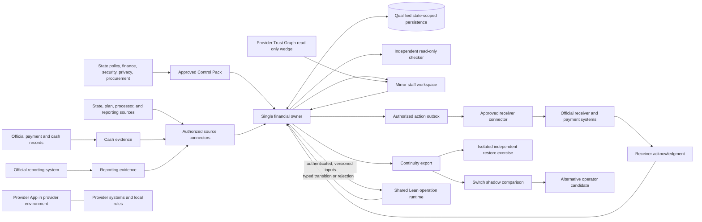

# RightRail full-stack production target

Updated: 2026-09-24
Owner: target architecture for the complete RightRail government service,
including its data, decision, operations, supplier, and exit boundaries.

The founder's final full-stack architecture directive (2026-09-23) governs the
intended end state; its runtime-convergence supplement defines the shared
operation pattern. The final directive supersedes earlier architecture
direction. `CONSTITUTION.md` is supreme; this document elaborates it and
cannot weaken it. It is the single detailed map of the target;
[`ARCHITECTURE.md`](../ARCHITECTURE.md) describes how today's code fits
together, and [`STATUS.md`](../STATUS.md) is the only status record. This
document holds no status. It does not select a state, program, deployment
profile, evidence mode, authority level, receiver, vendor, or live cutover.

The owner plan proposes the first government financial service as one
complete, recurring financial responsibility. It keeps the approved
requirements and population, reconciles incoming evidence, tracks disputes and
corrections, and prepares supported decisions for human approval. Existing
official payment systems retain money-movement authority. The read-only
Provider Trust Graph is a separate first commercial Mirror wedge, not a
substitute for this service. Its engagement and launch sequence are separate;
no common engagement or shared launch sequence is selected.

## 1. Product values and invariants

1. **Finish the defined responsibility.** Define the period, starting
   population, approved rules, evidence requirements, allowed adjustments,
   decision owner, correction process, and completion evidence before saying
   work is complete. A clean-looking report cannot establish that omitted
   items do not exist.
2. **Keep state authority explicit.** The state owns its policy, source
   permissions, population definition, approvers, exceptions, official
   consequences, and selection of any profile. RightRail prepares and records
   work within that grant.
3. **Use one financial writer.** One owner commits the financial history,
   current projection, and action/outbox identity atomically. A user interface,
   connector, proof verifier, candidate operator, or restore process never
   creates a second live writer.
4. **Keep facts distinct.** Evidence, an evaluation, an official
   determination, an authorized action, dispatch, receiver acknowledgment,
   cash movement, and reporting completion are different facts. A receipt or
   acknowledgment proves only what its issuer and contract attest; neither is
   cash confirmation.
5. **Prove completeness at the source boundary.** Bind every population to
   its source, scope, period, cutoff, inclusion rules, change history, and
   completeness evidence. An incomplete or ambiguous feed cannot establish
   absence. Two copies derived from one source are not independent
   corroboration.
6. **Bind each result to its authority and version.** Evaluations and actions
   identify the exact responsibility, Control Pack version, owner revision,
   evidence references, source authority, and effective interval. A caller
   cannot choose a weaker evidence mode, policy version, or fallback.
7. **Make retries and recovery deterministic.** Commands carry an explicit
   identity, expected revision, canonical input identity, and retry rule.
   Exact retry is idempotent; changed input conflicts. Recovery covers exits
   before commit and after commit when the response is lost.
8. **Fail closed without losing work.** Missing, stale, malformed,
   unauthorized, over-limit, or contradictory input creates no partial
   financial transition. The unresolved work and its owner remain visible.
9. **Minimize data and custody.** Sensitive records, source payloads, and
   state keys stay in their approved state, provider, or payer boundary.
   Corporate support, analytics, monitoring, and external tools receive no
   PHI or persistent linkable claim fingerprint.
10. **Make operation replaceable.** The state retains practical rights to its
     approved rules, history, configurations, interfaces, tests, and handoff.
     Conformance tools and vendor interfaces are usable without a proprietary
     toll. Commercial value does not depend on denials, recoveries, penalties,
     or savings.

### Governing acceptance predicates

These predicates make the [design ideology](DESIGN_IDEOLOGY.md) enforceable
at each boundary. The linked document governs the full rationale and
invariant definitions.

- **Invariant-first evidence and gate changes:** Every gate names the
  invariant and protected failure mode and is supported by raw, reproducible
  evidence. For a stale, over-broad, or non-applicable gate, record its exact
  predicate, protected failure mode, raw reason, replacement control, scope,
  duration, and claim consequence before changing it. Any changed or weakened
  gate receives no prior qualification credit until its documented replacement
  is requalified.
- **Small, single-writer trusted core:** Keep one canonical financial owner
  and narrow, versioned interfaces. Each module declares what it owns,
  receives, may mutate, and which evidence supports that mutation; independent
  checks reconstruct results at the boundary. No connector, verifier, UI,
  restore, or sidecar creates a second ledger or live writer.
- **Separate facts and authority:** Type and preserve source evidence,
  official determination, authorized action, dispatch, receiver acknowledgment,
  cash movement, and reporting completion as distinct facts. A receipt or ACK
  cannot stand in for official cash evidence.
- **Exact retries and both recovery sides:** Bind each command to identity,
  expected revision, canonical payload, and retry rule. An exact retry is a
  duplicate; changed input conflicts. Evidence covers process exit before
  COMMIT and committed state with a lost response, including concurrency and
  recovery.
- **Deterministic money and hostile-source negatives:** Use integer cents,
  versioned schemas, stable ordering, bounded parsing, and manually derived
  expected cents. Source tests include omission, duplication, replay, stale
  revision, wrong scope, wrong period, wrong mode, and incomplete or ambiguous
  inputs; failures cannot create partial transitions.
- **Executable formal semantics with deployed linkage:** Implement executable
  Lean semantics where the contract is realistically formalizable. Treat Lean
  as non-authoritative until a pinned artifact is linked through reviewed
  refinement and the deployed adapter to the owner, with theorem, mutation,
  known-answer, and resource evidence. No runtime authority switch follows
  from a standalone proof or port.
- **Zero corporate PHI and state custody:** Corporate support, monitoring,
  analytics, and external tools receive zero PHI and no persistent linkable
  claim fingerprint. The state retains usable custody and control of its
  rules, data, keys, histories, interfaces, tests, and continuity materials.
- **Free replacement and neutral economics:** State and replacement operators
  can use documented interfaces, conformance tests, and handoff materials
  without a proprietary toll. Economics do not depend on denials, recoveries,
  penalties, or savings; every product claim stays within the raw evidence
  recorded in `STATUS.md`.

## 2. System boundary and data flow

The production data plane runs in an environment approved for the selected
state responsibility. That may be state-operated or another explicitly
approved environment; local hosting alone does not settle privacy, custody,
contract, or access questions. Common product engineering and cross-state
reuse receive only material approved for sharing.

The target runtime pattern is authenticated/versioned inputs → executable Lean
operation → precise rejection or typed permitted transition → atomic commit by
the responsible owner → durable receipt/history, captured dependencies, and
follow-up identity → approved projections and reports. Reuse this pattern only
where meanings match; Financial, Queue/Composition, direct State clearance,
Mirror Ingress/Core/Recovery, and provider-local operation retain distinct
owners, stores, and authority. Typed interfaces grant minimum capabilities;
use process isolation where privilege or resource boundaries require it, not a
service per logical module.

Reads record the identity, version, and watermark for consulted records, rules,
sources, software, authority, and time. Supported collection, range, and
absence queries also return a dependency that detects a later relevant
insertion. The accepted transition durably records required follow-up work;
projection, report, export, and reconciliation workers may run after commit
and must resume with exact idempotent retries. Unsupported dependency meaning
forces re-evaluation. Do not generalize these shared mechanics until the
financial correction slice and one genuinely different nonfinancial/read-only
workflow have passed, preferably an existing Provider Trust Graph or Mirror
discrepancy path.

The diagram is a logical target, not a selected vendor topology. The source
connector authenticates and records what arrived. The financial owner applies
the approved rules and owns the state transition. The receiver connector
delivers only an already-authorized action. Independent cash and reporting
records return as separate evidence. The checker reconstructs results without
writing the owner's state. Mirror uses the owner, and continuity and shadow
copies cannot dispatch.

## 3. Versioned interface contracts

Existing local contract names are `RR/FINANCIAL/OWNER/v8`,
`RR/FINANCIAL/CONTINUITY/v8` (v7 converts on owner open and v7 packages stay
verifiable; v5/v6 retired 2026-09-24), `RR/FINANCIAL/COMMAND/v1`, and
`RR/FINANCIAL/EVALUATION-RECEIPT/v1`. Production schemas
remain owned and versioned at their actual boundary; breaking a contract
requires a new version, explicit migration, and independent acceptance.

Every interface carries a contract identity and version plus the identity of
the responsibility it concerns. A mutable owner command also binds a command
ID, authenticated principal and authorization reference, Control Pack
identity, expected owner revision, and canonical payload identity. A factual
source event binds source authority and schema/version, source record and
version, event identity, applicable scope and period, source/effective time,
receive time, and its completeness or correction relationship. Raw payloads
and any identifying digest remain inside the approved data boundary.

The following are the minimum logical contracts. They define ownership and
meaning without asserting that these names or field layouts are implemented
wire schemas.

| Interface | Producer -> consumer | Required binding and authority effect |
| --- | --- | --- |
| Control Pack reference | State approver -> financial owner | Pack ID/version/content digest, responsibility scope, effective interval, source/rule/test references, and approval identity. Selects approved meaning; does not itself establish source completeness. |
| Population manifest | Source owner/authorized connector -> financial owner | Source and scope, period/cutoff, inclusion and exclusion rules, expected/received counts, rejects/changes, watermarks, and supporting completeness references. A boolean or count alone cannot establish completeness. |
| Evidence envelope | Authorized connector -> financial owner | Source authority and schema, record/version, event/delivery identity, scope, source/effective/received times, correction relationship, and state-local payload reference. Authentication establishes origin/integrity, not truth. |
| Owner command | Mirror or authorized service -> financial owner | Command identity, principal/role/approval reference, scope, Control Pack, expected revision, and canonical payload identity. Only the owner may commit a financial transition. |
| Evaluation receipt | Financial owner -> Mirror/checker | `RR/FINANCIAL/EVALUATION-RECEIPT/v1` binds evaluation/obligation/revision, Control Pack, sorted evidence references/digests, authority/epoch, time, result fields, and digests. It is not a determination or payment authority. |
| Action outbox | Financial owner -> approved receiver connector | Authorized decision, action identity, scope, destination, payload identity, and retry key. The connector cannot invent or broaden an action. |
| Receiver acknowledgment | Official receiver -> financial owner | Receiver identity, acknowledgment event, action correlation, status, and time. Confirms only the receiver's contracted acknowledgment, not cash or reporting completion. |
| Cash/reporting event | Official financial/reporting source -> authorized connector -> owner | Independent source and record identity, scope, period, event time, and correction lineage. Maintains cash and reporting as separate statuses. |
| Continuity package | Owner export -> isolated importer | Owner/schema/control versions, scope, sequence/time, counts, digest, histories, open work, outbox state, evidence references, and migration lineage. It cannot carry live credentials or grant writer authority. |
| Shadow result | Candidate operator -> independent comparer | Candidate/software and rule versions, identical input identity, output and difference set, resource/failure result, and evidence that no live side effect occurred. It grants no cutover authority. |
| Cutover grant | State approver -> old/new owner boundary | Exact responsibility scope, old/new operator, effective time, approvals, fenced writer epoch, in-flight treatment, and rollback reference. It is separate from shadow acceptance. |

### Control Pack and population manifest

The Control Pack interface to the owner binds:

- a pack ID, version, canonical content digest, responsibility scope, and
  effective interval;
- each governing source, source version, approved interpretation, and the
  method used to calculate or adjust an obligation;
- the population definition, required evidence, deadlines, exception roles,
  authorized actions, and tests with independently derived expected values;
- state approver identity, approval reference, approval time, and any
  superseded pack or withdrawal plan.

A separate population manifest identifies its source and source owner,
responsibility, period, cutoff, inclusion and exclusion rules, expected and
received counts, rejects, replacements and late changes, watermarks, and the
receipts or independent references supporting completeness. A count or
source-supplied `complete` flag alone is insufficient. The state approves the
population before evaluation; uncovered or unexplained items stay unresolved.
Historical results retain the Control Pack version that governed them.

### Source evidence envelope

The source connector preserves a source-local raw reference and emits only
the minimum typed evidence needed by the owner. Its envelope identifies source
authority, schema/version, record ID/version, event or delivery ID, scope,
source and effective times, receipt time, correction/replacement links, and
the applicable population-manifest or completeness evidence. Authentication
establishes origin and integrity under that source contract; it does not prove
the source told the truth. Independent records or counts are required where
the conclusion depends on completeness or corroboration.

Adapters are allow-listed, bounded, versioned, and permissioned for the
specific state. They preserve rejects, watermarks, and reconciliation
references; they do not discard source history, turn parse success into
acceptance, or make a policy decision. Connector outage, gap, schema change,
or late data is visible to the state and cannot silently close the population.

### Owner command and evaluation receipt

The owner accepts typed commands only through its versioned contract. Each
command binds identity, caller authority, scope, expected revision, approved
Control Pack, and canonical input. The owner alone decides whether an exact
retry is a duplicate or changed input is a conflict. It commits the history,
projection, and any authorized outbox row together.

The existing `RR/FINANCIAL/EVALUATION-RECEIPT/v1` binds scope,
evaluation/obligation/revision, Control Pack ID/version/digest, sorted unique
evidence ID/record-digest bindings, trusted authority ID/epoch/digest,
timestamp, result fields, result digest, and receipt digest. It carries
references and digests, not raw evidence or signatures. An evaluation receipt
is not an official determination or authority to pay.

### Action, receiver acknowledgment, cash, and reporting

An authorized action is a separate owner record linked to its decision,
approving role, exact scope, action identity, destination route, and payload
identity. A durable outbox passes that exact action to a state-approved
receiver connector. The receiver response identifies its own event and the
accepted or rejected command; replay uses the same idempotency identity.

Cash and reporting arrive through distinct official records. A receiver
acknowledgment means the receiver acknowledged the message under its contract;
it does not establish that money moved, that a recipient received it, or that
reporting reconciled. Closure follows the evidence and completion test in the
Control Pack. A cash correction can be complete while its reporting
correction remains open.

## 4. Authority and evidence are independent dimensions

Authority describes what RightRail may do. Evidence mode describes how a
fact is supported across a boundary. Neither dimension selects the other, and
no caller may promote evidence acceptance into a decision or action.

### Authority progression

1. **Observation and human decision.** The service assembles evidence,
   identifies uncertainty, tracks a case, and prepares a decision package.
   An authorized state official decides matters requiring judgment and
   approves any consequential action. This is the intended first-service
   posture.
2. **Narrow automation.** A state may separately approve a specific
   deterministic check with named scope, rule version, valid time, input
   requirements, limits, override, review, monitoring, and fallback. A
   failure, missing fact, or ambiguity cannot turn into an adverse decision
   through a default.
3. **Transfer or cutover.** A state may later approve a precisely bounded
   function for another operator. Transfer has its own authority, active
   writer fence, reconciliation, and rollback plan; passing a comparison or
   proof gate does not grant transfer authority.

Progression is never automatic. Each step requires state approval and its own
acceptance evidence. The current documentation selects no authority level.

### Evidence modes

The governed profile, once one is approved, selects the permitted evidence
mode for its exact facts and scope:

- **`DIRECT_STATE_OWNED`** uses canonical facts lawfully held in the state
  boundary. It does not need a cryptographic proof wrapper merely because a
  fact is sensitive. Source authority, completeness, rule interpretation, and
  state determination remain independently governed.
- **`AUTHORITATIVE_ASSERTION`** uses a narrowly scoped assertion from a
  qualified source. Its signature can bind issuer, provenance, version,
  operation, and validity interval; signature acceptance alone does not prove
  factual truth, population completeness, or state disposition.
- **`PRIVATE_ZK`** is conditional on a need to verify a source-bound hidden
  predicate without disclosing its inputs. The exact relation, source binding,
  privacy claim, soundness assumptions, resource profile, verifier, and
  receipt must qualify together. Proof acceptance is evidence only, never a
  directive or payment action. Its soundness gates apply only if this mode is
  selected.

Evidence mode is fixed by an approved profile, not by a request, source,
provider, caller, or failed fallback. A missing or mismatched mode fails
closed. These modes are orthogonal to observation, automation, and transfer;
none is selected here. The parked `PRIVATE_ZK` trust boundaries are in
[`parked/private_zk/docs/DATABASE_ZK_ARCHITECTURE.md`](../parked/private_zk/docs/DATABASE_ZK_ARCHITECTURE.md)
and
[`parked/private_zk/docs/NATIVE_V3_ARCHITECTURE.md`](../parked/private_zk/docs/NATIVE_V3_ARCHITECTURE.md).
The three evidence modes do not imply three permanent application runtimes;
they remain separate ways to establish evidence under one shared operation
pattern.

## 5. The five product parts

### 5.1 State Control Pack

The Control Pack is the state-approved, versioned implementation record for
one responsibility. It connects each requirement to its source, effective
period, approved interpretation, deterministic rule where possible, required
evidence, exception path, accountable role, and conformance test. It records
judgment as an authorized decision path instead of hiding it in executable
code. Artificial intelligence may help draft an analysis or test; only the
state-approved version is executable.

Rule changes are staged against the population and periods they affect. Old
versions remain available for historical explanation. Tests cover the old
and new effective intervals and any required correction of earlier work.
Approval and withdrawal are explicit and auditable.

### 5.2 Blind Ledger financial owner

The financial owner is the one writer for obligations, typed evidence
references, evaluations, cases, determinations, corrections, balances,
authorized actions, and action/outbox identity. It checks the exact
Control Pack, population, source references, authority, and expected revision.
It atomically records history, current projection, and an authorized outbox
transition. It uses integer amounts, deterministic ordering, bounded
decoding, and explicit retry behavior.

The owner does not create official policy, decide source truth, move funds,
or treat dispatch as settlement. It records the state determination and
descriptive cash/reporting facts separately. It can close only under the
completion rule approved for the responsibility. A `HOLD`, `HUMAN_REVIEW`,
`BLOCK`, or unsupported result cannot advance an economic state.

Lean is the default for executed application logic wherever practical. Keep
storage, identity, source, network, and cryptographic effects behind narrow
interfaces, and preserve working implementations during migration. Use the
existing SQLite store for the first migration with explicit durability
settings; replace it only when measured contention, deployment, or recovery
needs justify that change. Avoid a custom database, generic workflow engine,
service per module, or second policy implementation.

The first Lean-controlled operation is
`FinancialOwner.reject_offset_and_authorize_correction`: Lean decides the
transition and the owner's atomic adapter commits it. Retries require the
evaluation identity and digest, expected revision, decision time, and
deterministic determination ID. The request binds authenticated principal and
scope, approved rule context, current-state dependencies, evaluation receipt,
expected revision, and durable command identity. The transition returns its
allowed mutation, ordered events, structured explanation, and authorized
follow-up; the adapter revalidates the read set and commits the decision,
history, projection, and action/outbox identity atomically. Exact retries are
duplicates, changed meaning conflicts, and runtime or adapter disagreement
fails closed. Determination, action, ACK, cash, and reporting remain separate;
the operation does not move funds.

Enforce export bounds without constructing a full Continuity package inside
each changed transaction. Remove any such
per-write full export or full-history verification only after every safety
condition has an equivalent control. Use bounded journal segments, verified
snapshots, resumable publication, and checked incremental projections; prove
incremental results agree with recomputation, including reversals, late
arrivals, replacements, duplicate evidence, rounding, and exceptional
adjustments. Keep full reconstruction for audits and recovery exercises.

Consequential reads must be authenticated against the current accepted state
commitment. A history hash alone does not prove that a query returned the latest
value, complete collection, or genuine empty result. Start with narrow proofs
for point values, membership/absence, and checked aggregates using a small
versioned index or equivalent mechanism whose updates match the same accepted
transition. Test deletion, missing keys, stale proofs, and omitted rows. Retain
independent checkpoints outside the database administrator's control under
approved custody; define freshness, conflicting branches, uncertain
finalization, key rotation, recovery, and bounded witness-outage behavior.
This is not a universal verifiable-SQL engine.

### 5.3 Mirror staff workspace

Mirror is the authenticated staff workspace over the same owner history. It
shows the obligation, applicable rules and dates, supporting evidence
references, differences, uncertainty, case owner, next action, deadline,
decision history, and separate cash and reporting statuses. Staff can drill
into records only through the approved state route.

Read commands use bounded, paginated owner queries. Decision and correction
commands return to the owner with the authenticated role, approval reference,
command identity, and expected revision. Mirror has no direct financial table
writes, independent policy store, hidden decision cache, or power to clear,
pay, or suppress a finding. Accessibility, role design, and human review
are part of acceptance, not an alternative authority path.

Mirror derives correction follow-up explanations, state reports, and
recipient-safe support from one current decision package. An event-backed
drain is bounded and repeatable; acknowledgment changes the follow-up status
without changing cash.

Provider Trust Graph is a separate, read-only commercial Mirror wedge for
source and provider evidence. It may expose an operational observation with
provenance; it cannot create a financial determination, clearance,
source-completeness claim, or action. The financial first service does not
depend on the wedge, and no shared engagement or launch sequence is selected.

### 5.4 Continuity State and independently reproducible exit

Continuity creates a bounded, versioned handoff from the same owner. Its
manifest binds the owner and schema versions, responsibility and Control Pack
identities, export sequence and time, record counts, package digest, evidence
references, migration lineage, and test bundle. Its content preserves the
authorized history and current work needed to continue: obligations,
decisions, receipts, corrections, balances, open cases, deadlines, pending
actions, outbox identities, receiver acknowledgments, and separate cash and
reporting status.

The state-approved package either carries source data it has a right to
transfer or carries resolvable references and permissions to the authoritative
source. A digest without access to the underlying evidence is not a
reproducible handoff. Secrets and private keys are not embedded in the
package; state-controlled key identifiers and an approved reauthorization
procedure preserve custody.

Restore first occurs in an isolated attempt. The importer validates the full
manifest, schemas, identity, dependencies, bounds, and cross-record
references, then independently reconstructs selected completed results and
open work. Publication is atomic and no-replace. SHADOW is query-only; TEST
is isolated and non-live. Neither may dispatch, egress, promote itself to a
live writer, replace a foreign destination, or change a source. Cleanup and
restore failures remain visible.

An exit exercise is independently run while the incumbent service still
works. A replacement receives state-authorized data and interface access,
reproduces expected results, reopens unresolved cases, continues a
representative cycle, and reports remaining gaps. The state verifies its
access, tools, permissions, references, approvals, and rollback path. An
export that parses but cannot be operated is not an accepted exit.

### 5.5 Switch: shadow comparison before any transfer

Switch replays synthetic, historical, or separately approved copies into an
alternative calculation or operator. The current official operator remains
the only live operator during shadow. Each candidate result binds the same
inputs, Control Pack, period, version, and test identity; the comparison
reports matches, expected differences, unexplained differences, resource
use, and unresolved compatibility questions. It does not treat incumbent
behavior as correct by default.

Cutover is a later state decision, separate from shadow acceptance. It names
the exact function, period, cases, old and new operators, effective time,
approvers, data and authority transfer, and completion test. The handoff
drains or accounts for pending commands and outbox work, verifies receiver
and cash/reporting state, fences the old writer, imports and independently
checks the new owner's state, and grants one new scoped writer epoch. No
interval permits both owners to mutate the same obligation.

Rollback is a new controlled transfer, not a database rewind. It fences new
work, reconciles actions already sent or acknowledged, preserves completed
cash and reporting facts, exports any new history, restores the prior
operator into an isolated attempt, independently checks it, and grants the
single active writer only after approval. Every retry across the boundary
retains its command identity.

## 6. Lean semantics and runtime correspondence

Use Lean for pure, deterministic semantics wherever it is realistically
useful across components: canonical decoding, control selection, rule order,
chronology, evidence/result interpretation, exception eligibility, replay,
retry, and allowed state transitions. Share proved semantics only through
reviewed versioned interfaces. Lean does not replace the owner, source
connectors, database transaction guarantees, user interface, operating
system, cryptographic backend, official receiver, custody, or operational
evidence.

The owner may call a Lean-produced runtime only after all of these are bound
to the exact candidate release:

1. pinned Lean toolchain, dependencies, source hashes, theorem manifest,
   executable artifact identity, and admitted-axiom inventory;
2. independent kernel/theorem checks and reviewed theorem statements;
3. canonical known-answer vectors and negative, mutation, replay, and
   malformed-input coverage consumed by an independent implementation;
4. a reviewed refinement/linkage argument from the proved definitions and
   canonical bytes through the deployed adapter to the owner's result;
5. fail-closed behavior for version, decode, result, timeout, resource, or
   runtime disagreement; and
6. bounded end-to-end resource and recovery evidence for the selected
   deployment profile.

The theorem manifest fails the build if a theorem disappears, its statement
changes without explicit review, or an unapproved axiom enters its dependency
closure; kernel checks, including an independent checker such as
`lean4checker`, run from a clean pinned build. The preferred deployment is a
Lean-compiled native artifact behind a narrow boundary: the adapter passes
exact canonical bytes and receives one typed result or a fail-closed error. An
adapter parser may reject malformed transport earlier but never replaces the
Lean decode or result. A primitive that cannot run inside the Lean artifact
needs a narrow external specification, independent known-answer tests, an
explicit trust assumption, and a demonstration that no semantic authority
moved; performance alone never justifies a separate unproved evaluator.
Lean proves the business relation and allowed transition; it does not make a
cryptographic backend sound, a source truthful, a policy lawful, or a database
durable. Database serializability and recovery need their own evidence.

For the clearance kernel the theorem statements may be refined as types
freeze, but these properties may not be weakened: evaluation is
deterministic; proof or session acceptance alone never implies `CLEAR`; a
read-only observation cannot create an operative clearance or economic
mutation; absence requires authoritative completeness; the underlying policy
result survives exception handling; an exception is valid only for the exact
role, subject, rule, amount or bound, reason, scope, interval and underlying
result; `HOLD`, `HUMAN_REVIEW` and `BLOCK` cannot advance economic state; a
mismatched control set cannot evaluate; chronology is strict; replay,
conflicting retry or a wrong before-state cannot advance state; every access
joins exactly one decision; canonical encoding round-trips and is injective;
and the audit checkpoint chain is append-only with no operational authority.

The first operation is accepted only when the pinned executable artifact, theorem
and axiom review, independent checks, known-answer and failure coverage,
reviewed refinement through the State adapter, and bounded recovery/resource
evidence bind to the exact candidate. Lean failure cannot invoke a duplicate
Python decision path. This is an implementation milestone, not a production
authority switch.

The vertical slice must also make the accepted result drive its durable
dependencies and follow-up, the same-state Mirror explanation, a state-internal
report, and a recipient-safe support output. Demonstrate that an unrelated
change preserves a still-valid result, a relevant new fact invalidates or
reopens the correct work, and a crash after the financial commit leaves
resumable follow-up. Remove whole-Continuity-package work from the normal write
path only after equivalent bounds, recovery, and retry protections are proven.
Then exercise these mechanics in one distinct nonfinancial/read-only workflow
before generalizing them.

## 7. Connectors, receiver, and separate product lanes

### State and contractor connectors

Connectors are enabled only for named sources the state can lawfully access.
Each specifies owner, direction, permitted fields, authentication, schema
and version, schedule or event trigger, cutoff and watermark, record identity,
retry and replay behavior, rejects, retention, correction duty, outage
escalation, and completeness evidence. Ingestion is read-only by default.
Any command or write connector has a separate state-approved scope and routes
through the owner's durable outbox.

State contracts must provide practical access to the records, receipts,
rejects, adjustments, relevant subcontractor equivalents, and payment
evidence required by the selected responsibility. Delegation does not erase
the state's rights or the accountable party's obligations. Connector
acceptance verifies partial delivery, late records, repeats, corrections,
revocation, schema drift, upstream omission, and recovery without duplicate
financial mutation.

### Official receiver and payment systems

The official receiver is external to RightRail. The state and receiver owner
approve the destination, action grammar, authentication, idempotency, signing
or acknowledgment meaning, timeout, reject, and escalation behavior. The
receiver connector cannot create an action the owner did not authorize. The
existing official payment system remains the money-movement authority.
Receiver acknowledgment, official cash evidence, and required reporting are
separately reconciled before the approved completion test passes.

### Provider App

Provider App is a separate provider-side product build track in an approved
provider environment. It offers local pre-submission checks against available
rules and supporting records. Claims use their normal approved submission
channel; clinical judgment, unavailable payer facts, and payment decisions
remain with their responsible parties. App outputs stay local unless a
specific state-approved sharing route exists. Government service scope, data,
procurement, and fees do not depend on provider adoption.

## 8. Cross-state reuse and vendor interfaces

The shared layer is a versioned, non-sensitive profile of interface schemas,
conformance requirements, public or synthetic test vectors, export formats,
supported software versions, and adapter behavior. It may identify evidence
that another authorized buyer could review; it does not contain a state's
provider list, rate, population, source records, local tests, case details,
policy interpretation, keys, or sensitive findings.

Each state separately approves the artifacts it may share, decides what
another state's evidence supports, evaluates local differences, and approves
its own Control Pack, source access, deployment, and release. A reused
connector or test reduces repeat work only where its version, conditions, and
local applicability are demonstrated. Evidence for an old vendor release is
not silently inherited by a new release.

Vendor interfaces and conformance kits are versioned, documented, and
available without a toll. Suppliers may implement against the same public
tests and submit their own results. RightRail does not control procurement,
exclude alternatives through private formats, charge an exit fee, or take a
share of denials, recoveries, penalties, sanctions, or savings. Independent
review remains separate from a vendor's own consequential delivery work.

Cross-state learning uses synthetic reproduction or explicitly authorized,
reviewed non-sensitive artifacts. There is no transfer of sensitive data
between states. Distribution can fail or be withdrawn without preventing a
state from operating its last locally approved version.

## 9. Production operations and control plane

### Environment, identity, and custody

Every deployment has separate state-scoped identity, network routes, data
stores, access policy, key references, and release configuration. The state
approves administrators, staff roles, contractors, service identities,
break-glass limits, retention, audit access, and revocation. Least privilege
is enforced at the API and storage boundary; a front-end role check alone is
not a security boundary. Every release pins each verifier, artifact, schema,
policy, governance, receiver, and custody identity by exact length and digest;
a missing, changed, duplicated, or downgraded identity blocks the release.

The state controls production keys through an approved KMS/HSM or equivalent
custody arrangement. Key generation, access, rotation, backup, revocation,
recovery, signing, and separation of duties are evidenced at deployment.
Documentation of an interface or algorithm is not HSM, FIPS, or key-custody
qualification. Keys are not carried in Continuity exports or ordinary
support packages. Signatures authenticate provenance and authority, not the
truth of what is signed. Rotation proposes old root, new root, successor epoch
and reason; collects the configured signatures and timelock; dry-runs
verification, replay, recovery, rollback, and export/restore on synthetic data;
publishes the new root and epoch atomically, rejecting partial or downgraded
records; and keeps the prior root read-only until its retention and recovery
duties end. A compromise pauses new state advances, preserves safe evidence,
rotates custody, and opens a non-PHI incident record.

### Release and configuration

Each release binds source revision, dependency lock, build provenance,
artifact hash, vulnerability review, test and theorem identities where
applicable, Control Pack compatibility, migration, and rollback artifact.
Signed releases move through state-approved environments with separation of
authoring, approval, and production deployment. A Control Pack change is
reviewed and versioned independently from a code release. A change cannot
silently reinterpret historical work.

Rules, semantic modules, adapters, codecs, conformance suites, migrations,
recipient-specific reports, and recovery formats use a small immutable
identity: stable ID, version, content digest, dependencies, compatibility,
provenance where applicable, attached evidence, and withdrawal/supersession
status. A state deployment selects approved artifacts, and historical
operations retain the identities used. Assemble and validate a versioned
deployment bundle with existing typed manifests and build tools; report
missing permissions, unresolved requirements, incompatibilities, tests,
resource envelope, migration, and withdrawal instructions without creating a
generic compiler service.

Roll back code only through a compatible, reviewed release plan. Restore data
from a qualified backup or continuity process; do not reverse committed
financial history by replacing a database file. New corrections are explicit
owner transitions linked to the original decision.

### Privacy, support, and incidents

State, provider, or approved payer environments retain sensitive inputs and
state keys. Corporate support and shared tooling receive zero PHI and no
persistent linkable claim fingerprint. Error messages, filenames, logs,
hashes, aggregates, dumps, and timestamps are treated as potentially
sensitive until reviewed. External AI tools do not receive raw or identifying
material.

Default support packages contain approved software and rule versions, a
bounded failure stage, fixed error code, and a synthetic reproducer when
possible. The state-side reviewer removes or approves every field before
release. If a defect cannot be reproduced safely outside the state, diagnosis
remains inside its approved environment. Employee access to live sensitive
data is disabled by default; any future emergency-access path requires
separate legal, state-security, contract, time-limit, monitoring, and
revocation approval before it can exist.

Incidents have an accountable on-call owner, severity and notification
rules, containment steps, evidence-preservation rules, recovery plan, and
state escalation route. State-visible service health includes source lag,
rejects, unresolved work age, retries, outbox state, receiver responses,
cash/report differences, owner errors, and failed restores without exposing
raw records. Monitoring itself is access-controlled and retention-limited.
Events carry only a fixed class, release and authority digests, epoch,
sanitized status, and a non-linkable correlation digest. Raw proofs, sources,
receipts, claims, provider identities, stable fingerprints, amounts, nonces,
credentials, keys, paths, host identifiers, stdout/stderr, payloads, and
exception text never appear in events, metrics, logs, exports, support, or
dashboards. Monitoring never selects a verifier, mutates state, or delivers
anything; an indeterminate event stays visible until independently resolved.

### Recovery, rollback, and capacity

The state approves recovery objectives, backup locations, retention, and
recovery roles for its service. Backups are encrypted under state-approved
custody and are restore-tested in an isolated environment. Recovery proves
owner identity, schema and rule versions, complete history, projections,
pending actions, exact retries, and no duplicate dispatch. Runbooks include
source outage, database outage, key loss, corrupted package, partial release,
receiver timeout, and an operator exit.

Capacity is measured over the complete admitted path: source ingestion,
independent checking, owner transaction, durable commit, Mirror query, outbox,
receiver acknowledgment, recovery, and support. Each stage has explicit
record/package, memory, process, timeout, queue, retention, and concurrency
bounds. Over-limit work is rejected or quarantined without partial mutation.
The state accepts workload assumptions and service objectives before a
production claim. Component benchmarks do not establish a system SLA. Any
selected `PRIVATE_ZK` profile retains the separate requirements in
[`parked/private_zk/docs/NATIVE_V3_ARCHITECTURE.md`](../parked/private_zk/docs/NATIVE_V3_ARCHITECTURE.md);
those are not a universal requirement for other evidence modes.

### Independent assurance and procurement

Independent reviewers receive direct, appropriately protected access to the
consequential requirements, test methods, retained results, defects, and
remediation evidence. A supplier does not solely certify its own consequential
work. Review covers the state policy mapping, population completeness,
independent expected answers, access controls, release, incident response,
recovery, continuity, exit, and any selected proof or native boundary.

Procurement defines one responsibility, permitted actions, data and interface
rights, source cooperation, service levels, deliverables, acceptance tests,
change scope, cost cap, remedies, support, independent review, renewal,
replacement, and tested exit. The state and its advisors control the
specification and evaluation; conflicts and pre-procurement assistance receive
legal review. Funding classification, security review, privacy roles, records
retention, and applicable approvals are confirmed for the actual deployment.

The founder-authorized commercial direction is approximately $2M annual
operations including implementation and covered changes, marginal 10/7/5
basis-point flow tiers with a 5-basis-point floor, and separate $5–$10 Provider
App economics. No outcome-linked share of denials, recoveries, penalties,
sanctions, or savings is permitted. These are direction-setting terms, not a
customer quote or contract approval; exact scope, denominator, covered-change
boundary, and contract pricing still require approval. Billing stays outside
operational authorization. No specific procurement route, law, or funding
treatment is selected here.

Comparable suppliers receive the same synthetic exercise: an omitted item, a
wrong rule version, a partial payment, a disputed adjustment, an incomplete
correction, a repeated message, an outage, and a restored export. Evaluation
records each supplier's supported answer, uncertainty, staff workload,
independent checks, and handoff usability; it does not require one vendor's
private format.

## 10. Component acceptance gates

Each entry is the acceptance gate a component must pass for a production
release. They are contracts, not statuses; results live in `STATUS.md`.

### Project-wide acceptance entry point

Extend existing build, test, review, and task tools into one documented
acceptance command. Discover modules, entry points, release
artifacts, and connections from repository configuration; any unclassified
addition remains incomplete until applicability is reviewed. Bind affected
requirements to implementation and exact source/build/configuration identities,
including dirty files and cross-project dependencies, plus their proof, test,
measurement, or authorized review. Unknown impact runs broader relevant checks.
Separate fast development checks, integration acceptance, and release
qualification; empty, missing, stale, or skipped runs remain incomplete.

Protect requirements, consequential specifications, theorem statements and
definitions, independent expected answers, gate selectors, required tests,
exception records, and approved resource budgets. Changes require explicit
review; a proposer cannot self-authorize a weaker requirement or certify its
own exception. Isolated synthetic fixtures must detect bypassed Lean logic,
forbidden output, changed retry identity, stale evidence, a disabled required
check, an unclassified module, and an unauthorized protected-requirement
change; a valid ordinary change must pass without unnecessary founder
intervention. Use trusted repository/release controls where available, no live
credentials or sensitive production data, and report which controls are
advisory or block integration/release. If stronger infrastructure is
unavailable, retain local controls and state the specific remaining setup
action once.

### State authority, Control Pack, and population

The state approves a versioned Control Pack and
population definition; the named source owner attests its manifest under
contract; source and independent count evidence reconcile; every rule maps to
expected tests; effective dates, correction scope, decision roles, and
completion evidence are reviewed; missing coverage remains visible.

### Source adapters and evidence modes

A named source owner and state approver accept the exact
scope, schema, authority, receipt, completeness, replay, correction, and
retention contract. Each admitted fact can be traced to its source and time;
an incomplete or ambiguous feed cannot establish absence. Only the
state-approved evidence mode is accepted.

### Financial owner and persistence

Independent checks reconstruct the governed inputs and
results; adversarial tests cover duplicate, changed, stale, cross-scope,
partial, concurrent, pre-commit, post-commit/lost-response, and recovery
cases; one writer atomically commits history, projection, and outbox; the
state accepts durability and recovery evidence.

### Mirror staff workspace

Authorized staff can trace every displayed status to
owner history and evidence, make only role-approved owner commands, review
uncertainty and due work, and distinguish decisions, actions, acknowledgments,
cash, and reporting. A denied command cannot mutate state, and every supported
action has a tested human fallback.

### Continuity and exit

A party other than the package producer restores into an
isolated target, validates the manifest and identity, independently
reconstructs completed results, reopens and continues representative work,
verifies pending actions and evidence access, and proves that the restore
cannot dispatch or create a second live writer. The state accepts the
exercise and a remediation/retest process.

### Switch and operator transfer

State-approved shadow runs produce reproducible
candidate inputs and explanations for all differences without side effects.
A separate cutover decision names scope, time, old/new operator, authority
epoch, pending action treatment, completion and rollback criteria. Tests prove
one active writer, idempotent retries, no duplicate action, and recovery of
all newly created state before authority changes.

### Lean, Native, and formal evidence

The exact production build binds theorem manifest,
dependencies, binary identity, canonical bytes, and reviewed refinement;
known-answer, mutation, differential, retry, recovery, malformed-input,
resource, and independent-verification gates pass for the selected contract.
No proof result supplies a policy decision, authority, or payment. A
`PRIVATE_ZK` soundness/privacy gate is conditional on selecting that mode.

### Official receiver, payment, and reporting

The state and receiver owners approve and test the exact
action contract, recipient and scope controls, command identity, retry,
timeout, rejection, acknowledgment, reconciliation, and incident path.
Independent official records distinguish message acceptance from money
movement and reporting completion.

### Production security, custody, privacy, and support

State security, privacy, legal, and data owners approve
the actual environment, roles, routes, keys, telemetry, logs, support
packages, retention, incident duties, and recovery. Adversarial tests show
sensitive data and stable identifiers do not escape approved boundaries;
access is revocable and independently auditable.

### Monitoring, disaster recovery, and capacity

End-to-end load and fault exercises cover source gaps,
bursts, storage limits, contention, receiver delay, process and database
failure, restore, and return to service. Results include per-stage resource
and latency measurements, duplicate/omission checks, recovery evidence, and
approved state RPO/RTO and capacity thresholds. No SLA is claimed before
acceptance.

### Independent audit and procurement

The state and independent advisor approve the comparison
exercise, evaluator separation, access and record rights, actual scope,
acceptance tests, security/privacy terms, cost ceiling, escalation and exit.
Funding and procurement decisions are recorded by their state owners.

### Cross-state profiles and vendors

Each state separately approves the reusable artifact
and its local delta, tests its own population and Control Pack, and records
the release it accepts. Shared material contains no sensitive state data;
release withdrawal and continued operation of the last local approval are
tested.

### Provider App

Provider checks stay in the approved provider
environment, identify checked rule/source/software versions, report
uncertainty, and do not imply payer authorization or payment. No PHI is sent
to corporate support and the government service works without the app.

## 11. Parallel build tracks and external launch gates

Build the complete product and operating capabilities before the VC pitch.
These construction commitments proceed in parallel; a narrowly scoped first
sale may change deployed scope but does not make the full target complete. They
describe work tracks, not a release sequence; the government service's release
gates remain in Section 12.

| Track | BUILD direction | Separate external launch gate |
| --- | --- | --- |
| First government financial service | Build toward one complete, recurring financial responsibility and its full data, decision, operations, supplier, and exit boundaries. No state, program, profile, or deployment is selected here. | The service follows its own release-gate sequence in Section 12. |
| Provider App | Committed full-stack BUILD track under the current owner instruction, in parallel with core construction and in the approved provider environment. | Actual provider adoption is a separate external gate for this track and is not a prerequisite for the first government service. |
| Non-sensitive cross-state conformance | Committed full-stack BUILD track in parallel with core construction for public/versioned interfaces, conformance requirements, and public or synthetic vectors; sensitive state data remains local. | A second state's acceptance is a separate external gate for cross-state use and is not a prerequisite for the first government service. |
| Provider Trust Graph | Separate, read-only first commercial Mirror wedge. | Its engagement and launch sequence remain separate; no common engagement or shared launch sequence is selected. |

Provider adoption and second-state acceptance gate their respective external
launches only. Neither is a launch prerequisite for the first government
service, and parallel BUILD work does not imply external adoption or approval.

## 12. Release order

1. Agree the full responsibility, accountable state owner, source rights,
   procurement/funding path, privacy boundary, human decision roles, and
   completion definition.
2. Approve and test the Control Pack, complete population, sources, and
   independently derived expected answers with synthetic data.
3. Reconstruct an approved historical period, resolve interpretation
   differences, and accept the evidence, owner, and staff workflow.
4. Run an approved parallel observation cycle beside the official process.
   The official operator remains authoritative; acceptance measures evidence
   gaps, unresolved work, corrections, staff effort, and failures.
5. Accept security, privacy, custody, monitoring, recovery, support,
   capacity, independent review, receiver, connectors, and exit for the
   actual deployment environment.
6. Operate the defined service with human-approved decisions and official
   payment systems. Retire only specifically accepted duplicate work.
7. Consider any narrow automation only through its own state approval and
   safety case.
8. Shadow an alternative with state-approved copies and tests. Consider
   transfer only through a separate cutover decision and single-writer,
   reconciliation, rollback, and continuity acceptance.

This sequence specifies gates, not a selected state or promised calendar.
Each actual acceptance result is recorded in `STATUS.md`. The first pilot may be narrow in deployment size, but it
must still complete one whole recurring financial responsibility.

## Related documents

- [Constitution](../CONSTITUTION.md)
- [Status](../STATUS.md)
- [Product entry point](../README.md)
- [How the code fits together](../ARCHITECTURE.md)
- [Design ideology](DESIGN_IDEOLOGY.md)
- [Provider App](../provider_app/README.md)
- [Parked private-proof track](../parked/README.md)
