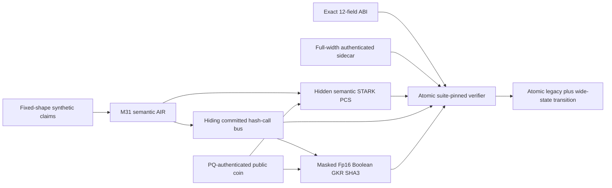

# BL-PQ512 hardening assessment

Status: **retired Stwo parameters remain no-go; the H4 strict-PQ prototype is functional but
nonactivating and not suite-qualified.**

Current architecture: conditional work now targets the atomic heterogeneous proof in
`docs/BL_PQ512_HETEROGENEOUS_HASH_COPROCESSOR.md`. The semantic M31 STARK and Fp16 Boolean GKR SHA3
coprocessor share one hiding bus and authenticated interactive transcript. Direct-SHA3-STARK
layouts remain negative baselines only.

Current planning interpretation: H4 executes the selected 168-layer native-masked Fp16 GKR,
Construction 8.2 PCS, 6,086-round dual-PQ authenticated transcript, atomic K128/K512 coordinator,
canonical parser, mutation gates, and independent verifier. The older R35 Circle-FRI/BaseFold
substrate is historical lineage, not an alternate current stack. Gate 2E state binding, complete
semantic-STARK composition and simulator, durable challenge custody/retry governance, H5 repeated
p95, H6 suite qualification, production verifier, and reproducible module identities remain open.

The review found no reason to abandon application-specific M31 arithmetic. It found two reasons the
current proof can never carry the requested security claim: QM31 is too small for the independent
field-error terms, and Blake2s-256 is too narrow for strict quantum collision security. The default
three-query configuration is additionally only a test profile.

## Priority proposals

| Priority | Proposal | Outcome |
| ---: | --- | --- |
| 1 | Keep M31 traces; widen every soundness challenge to a reviewed M31 degree-16 field | Selected direction; H4 Fp16 GKR and verifier execute, while complete composed theorem and production qualification remain open |
| 2 | Replace proof transcript and every PCS/Merkle layer with typed, full-width SHA3-512 | H4 uses SHA3-512-authoritative roots, transcript, answer code, targets, manifest, and independent verification with no truncation or felt reduction |
| 3 | Use PQ-authenticated interactive public coin for the authoritative launch transcript | H4 executes ML-DSA-87 plus SLH-DSA-SHAKE-256f authenticated public coin; durable custody/retry/liveness remain open |
| 4 | Implement and qualify the selected PCS from full relation bounds | Construction 8.2 executes in H4; full semantic composition, theorem ledger, H5, and H6 remain open. Circle-FRI/BaseFold is historical only |
| 5 | Add complete native masking for every selected private oracle and message | H4 verifies 508 GKR mask constraints per shard and the masked auxiliary plane; semantic-STARK/state coverage and complete simulator remain open |
| 6 | Authenticate a canonical metadata sidecar separately from the opaque proof body | Required to preserve the 12-field ABI without weakening authority |
| 7 | Pin the suite out of band and reject proof-supplied configuration before allocation | Required to prevent downgrade and parser/DoS attacks |

## Rejected shortcuts

- More FRI queries alone: does not reduce composition/OODS/LogUp field terms.
- More grinding alone: does not widen the field or hash and is a poor throughput trade.
- M31 octic challenges: less than 248 raw bits before losses.
- Treating twelve felts as one wide digest: cryptographically false.
- Salting public outputs without native oracle hiding: does not hide the transcript.
- Keeping proof-selected parameters: permits downgrade and resource abuse.

## Review boundary

S07-S09 remain open. The construction must not be called suite-qualified until internal
qualification closes the complete composed theorem/error/abort ledger, semantic-STARK and state
binding, public-coin custody, zero-knowledge simulator, repeated p95 campaign, production verifier,
reproducibility, and final module identities.
Only the finished sealed release then enters independent audit. See
`docs/BL_PQ512_S09_INTERNAL_SOLUTION.md`, the numbered proposals in this directory, and the canonical
analysis in `docs/BL_PQ512_SECURITY_FREEZE.md`.
