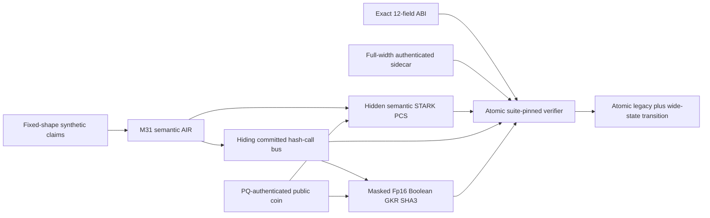

# BL-PQ512 hardening assessment

Status: **no-go for the current S-two parameters; conditional go for continued architecture work.**

Current architecture: conditional work now targets the atomic heterogeneous proof in
`docs/BL_PQ512_HETEROGENEOUS_HASH_COPROCESSOR.md`. The semantic M31 STARK and Fp16 Boolean GKR SHA3
coprocessor share one hiding bus and authenticated interactive transcript. Direct-SHA3-STARK
layouts remain negative baselines only.

Current planning interpretation: the replacement construction direction is selected for internal
engineering. The degree-16 algebra and PQ-authenticated interactive public-coin references now
execute and pass focused KAT/attack gates. R35 additionally implements a nonactivating scalar
Circle-FRI/cross-domain PCS substrate, exact interface parameter sweep, typed theorem-message
schedule, native-hiding worksheet, and cross-language gap/width/power/fold schedule KAT. Production
It also has a cross-language constructive direct Circle trace-evaluation-map certificate covering
the OODS point, its transition translate, and base queries, plus a canonical quotient mask/source-
aligned split rule and a byte-oriented low-degree SHA3-512 round AIR. Production application hash-
port and lookup-interaction expansion, PCS integration, selected
parameters, complete Circle simulator, production prover/verifier, retry governance, final proof
grammar, and module identities must still be implemented and internally qualified before the exact
release can enter the one final independent Security Audit Gate defined by
`docs/DEPLOYMENT_READY_BUILD_CONTRACT.md`. This addendum changes no R23 rejection of the current
kernel.

The review found no reason to abandon application-specific M31 arithmetic. It found two reasons the
current proof can never carry the requested security claim: QM31 is too small for the independent
field-error terms, and Blake2s-256 is too narrow for strict quantum collision security. The default
three-query configuration is additionally only a test profile.

## Priority proposals

| Priority | Proposal | Outcome |
| ---: | --- | --- |
| 1 | Keep M31 traces; widen every soundness challenge to a reviewed M31 degree-16 field | Selected direction; local reference KATs pass, production module remains open |
| 2 | Replace proof transcript and every PCS/Merkle layer with typed, full-width SHA3-512 | R35 typed commitments and executable byte-oriented SHA3 round AIR exist; R36 historically classified 50 live callsites and proved the packed-oracle plus compact dense-claim schedule at 14,322/28,644/57,288 permutations. H0 now independently reconciles 79/79 current callsites, 39 `AIR_REQUIRED`, with all five post-R36 additions dynamically measured and new-file/noncanonical-form bypass attacks rejected; current K128 bus mapping/resources and the shared bus remain open. No truncation or felt reduction. |
| 3 | Use PQ-authenticated interactive public coin for the authoritative launch transcript | Selected direction; removes launch Fiat--Shamir/QROM dependency, production adapters/retry ledger open |
| 4 | Implement paper-covered Circle-FRI layout and derive parameters from full AIR bounds | R35 scalar/interface layer covers real domain gaps, varying widths, global batching powers, and all interface fold rounds; final expanded AIR, parameter selection, and production engine required |
| 5 | Add complete native masking for trace, quotient, lookup, DEEP, and FRI oracles | R35 trace-bound/FRI-mask interfaces, direct trace-evaluation CRT certificate, and canonical quotient-mask/split-rule kernel exist; final split degree/integration, Circle simulator, and final oracle coverage required |
| 6 | Authenticate a canonical metadata sidecar separately from the opaque proof body | Required to preserve the 12-field ABI without weakening authority |
| 7 | Pin the suite out of band and reject proof-supplied configuration before allocation | Required to prevent downgrade and parser/DoS attacks |

## Rejected shortcuts

- More FRI queries alone: does not reduce composition/OODS/LogUp field terms.
- More grinding alone: does not widen the field or hash and is a poor throughput trade.
- M31 octic challenges: less than 248 raw bits before losses.
- Treating twelve felts as one wide digest: cryptographically false.
- Salting public outputs without native oracle hiding: does not hide the transcript.
- Keeping proof-selected parameters: permits downgrade and resource abuse.

## Review boundary

S07-S09 remain open. The construction must not be called secure until internal qualification closes
the production field module, error/abort ledger, interactive theorem and schedule, FRI layout, query
count, public-coin adapters, domains, encodings, sidecar, proof grammar, and zero-knowledge simulator.
Only the finished sealed release then enters independent audit. See
`docs/BL_PQ512_S09_INTERNAL_SOLUTION.md`, the numbered proposals in this directory, and the canonical
analysis in `docs/BL_PQ512_SECURITY_FREEZE.md`.
